# ЛР3. Серверная часть приложения на Django и Django REST Framework

**Задание:** Реализовать серверную часть приложения, используя фреймворк Django, Django REST Framework, Djoser и СУБД PostgreSQL, в соответствии с вариантом задания.

**Цель:** овладеть практическими навыками по реализации REST API средствами Django REST Framework.

**Стек:** Python 3.14, Django 5.2, Django REST Framework, Djoser, PostgreSQL

**Вариант 18 - Страхование** - система управления договорами страхования с физическими лицами и юридическими организациями.

---

## 1. Модель данных

| Модель | Описание | Ключевые поля |
|---|---|---|
| **Agent** | Страховой агент | `first_name`, `last_name`, `middle_name`, `passport_series`, `passport_number`, `phone`, `email` |
| **EmploymentContract** | Трудовой договор с агентом (прием/увольнение) | `agent` (FK), `hire_date`, `fire_date` (NULL = агент работает) |
| **Organization** | Организация для коллективного договора | `code`, `full_name`, `short_name`, `address`, `bank_number`, `specialization` |
| **Individual** | Физическое лицо | ФИО, `birth_date`; возраст - вычисляемое свойство `age` |
| **RiskCategory** | Категория риска | `name` (первая, вторая, высшая и т.п.) |
| **Contract** | Страховой договор | `contract_type` (individual / collective), `conclusion_date`, `start_date`, `end_date`, `agent` (FK), `organization` (FK, nullable), `individual` (FK, nullable) |
| **ContractTariff** | Тариф: сумма выплат по категории риска (промежуточная модель m2m) | `contract` (FK), `risk_category` (FK), `payout_amount` |
| **InsuredPerson** | Застрахованный сотрудник в договоре (промежуточная модель m2m) | `contract` (FK), `individual` (FK), `risk_category` (FK) |
| **InsuranceCase** | Страховой случай | `insured_person` (FK), `case_date`, `reason`, `decision` (paid / denied / pending), `payout_amount` (NULL, если отказ) |

**Связи:**

- `Contract.agent -> Agent` (многие-к-одному) - каждый договор заключает ровно один агент
- `Contract.organization -> Organization` (многие-к-одному, nullable) - заполняется у коллективного договора
- `Contract.individual -> Individual` (многие-к-одному, nullable) - заполняется у индивидуального договора
- `Contract ↔ RiskCategory` (многие-ко-многим **через** `ContractTariff`) - договор задает сумму выплат по каждой категории
- `Contract ↔ Individual` (многие-ко-многим **через** `InsuredPerson`) - в договоре оформлено несколько сотрудников
- `EmploymentContract.agent -> Agent` (многие-к-одному) - история приема и увольнения агентов
- `InsuranceCase.insured_person -> InsuredPerson` (многие-к-одному)

**Разделение данных:**

- Коллективный и индивидуальный договоры - одна модель `Contract` с полем `contract_type` (choices) и двумя необязательными FK: у коллективного заполнена `organization`, у индивидуального - `individual`
- Постоянные данные человека (ФИО, дата рождения) - в `Individual`; переменные данные участия в конкретном договоре (категория риска) - в `InsuredPerson`
- Сумма выплат по категории сотрудника - в `ContractTariff`; фактическая выплата по страховому случаю - в `InsuranceCase.payout_amount`
- Работающий агент - `fire_date IS NULL`; действующий договор - `start_date <= сегодня <= end_date`
- Все FK - `on_delete=CASCADE` с `related_name` (используется в запросах, например `contracts__`, `insured_persons__`)

---

## 2. Эндпоинты

### CRUD по сущностям (`api/`)

Views на дженериках DRF: `ListCreateAPIView` (GET / POST) и `RetrieveUpdateDestroyAPIView` (GET / PUT / PATCH / DELETE одного объекта).

| URL | Сущность |
|---|---|
| `/api/agents/` + `/api/agents/<pk>/` | Страховые агенты |
| `/api/employment-contracts/` + `/<pk>/` | Трудовые договоры (POST - принять агента, PATCH с `fire_date` - уволить) |
| `/api/organizations/` + `/<pk>/` | Организации |
| `/api/individuals/` + `/<pk>/` | Физические лица |
| `/api/risk-categories/` + `/<pk>/` | Категории риска |
| `/api/contracts/` + `/<pk>/` | Страховые договоры |
| `/api/tariffs/` + `/<pk>/` | Тарифы (суммы по категориям) |
| `/api/insured-persons/` + `/<pk>/` | Застрахованные сотрудники |
| `/api/insurance-cases/` + `/<pk>/` | Страховые случаи |

### Вложенные GET-запросы

| URL | Что возвращает |
|---|---|
| `/api/contracts/<pk>/nested/` | Договор со вложенными тарифами и застрахованными - связь многие-ко-многим |
| `/api/organizations/<pk>/nested/` | Организация со вложенными договорами - связь один-ко-многим |

### Авторизация (Djoser, токены)

Аутентификация DRF - `TokenAuthentication`. Регистрация и управление токенами - средствами Djoser:

| Method | URL | Что |
|---|---|---|
| POST | `/auth/users/` | регистрация |
| POST | `/auth/token/login/` | получить token |
| POST | `/auth/token/logout/` | выйти (отозвать token) |
| GET | `/auth/users/me/` | текущий пользователь (по заголовку `Authorization: Token <ключ>`) |

### Аналитические запросы (по варианту 18)

| URL | Что возвращает |
|---|---|
| `/api/analytics/organizations/<id>/same-agents/` | 1. Другие организации, застрахованные теми же агентами, по действующим договорам |
| `/api/analytics/agents/contracts-count/?date_from=…&date_to=…` | 2. Количество договоров каждого типа у каждого агента за период |
| `/api/analytics/individuals/<id>/colleagues/` | 3. Застрахованные того же действующего коллективного договора для персоны |
| `/api/analytics/payouts-by-type/?date_from=…&date_to=…` | 4. Общая сумма выплат по каждому типу договоров за период |
| `/api/analytics/organizations/report/` | 5. Реквизиты договоров юрлиц и суммы выплат по категориям |
| `/api/analytics/firm-report/` | 6. Сводный отчет: договоры по типам, суммы по агентам и по фирме |

---

## 3. Реализованные запросы

### 3.1 Список договоров

`GET /api/contracts/` - все 7 договоров. У коллективных (id 8–11) заполнено поле `organization` и `individual: null`, у индивидуальных (id 12–14) - наоборот.

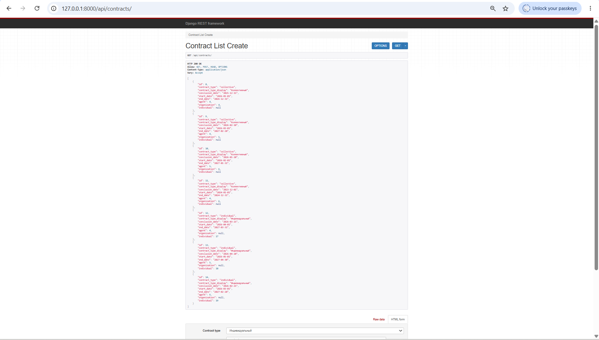

### 3.2 Договор с вложенными объектами - многие-ко-многим

`GET /api/contracts/8/nested/` - коллективный договор с АО «Медик»: агент, реквизиты, вложенные `tariffs` (сумма выплат по каждой категории риска через `ContractTariff`) и `insured_persons` (застрахованные сотрудники через `InsuredPerson`).

На скрине: три тарифа (Первая - 150 000, Вторая - 250 000, Высшая - 300 000) и три застрахованных сотрудника.

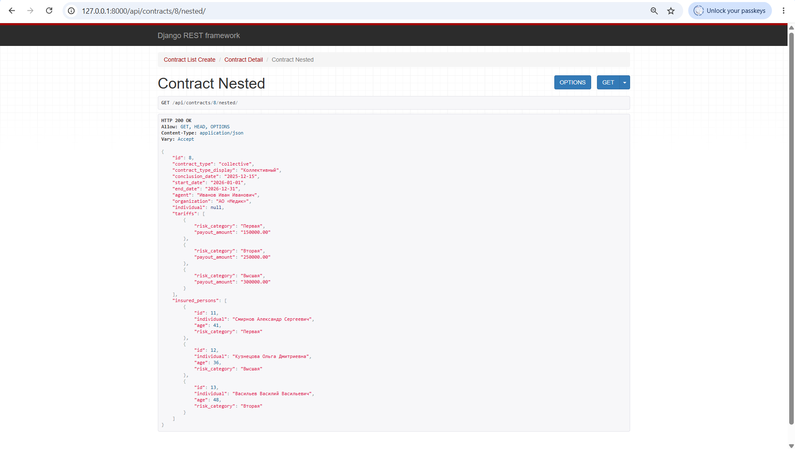

### 3.3 Организация с вложенными договорами - один-ко-многим

`GET /api/organizations/6/nested/` - Университет ИТМО со всеми своими договорами (обратная связь `related_name='contracts'`).

На скрине: два договора - действующий №10 (2026–2027, агент Петров) и просроченный №11 (2024, агент Иванов).

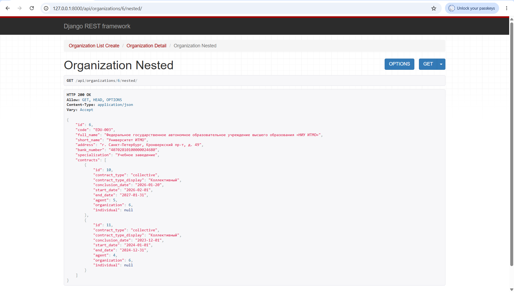

### 3.4 Создание агента

`POST /api/agents/` - ответ `201 Created` с созданным объектом.

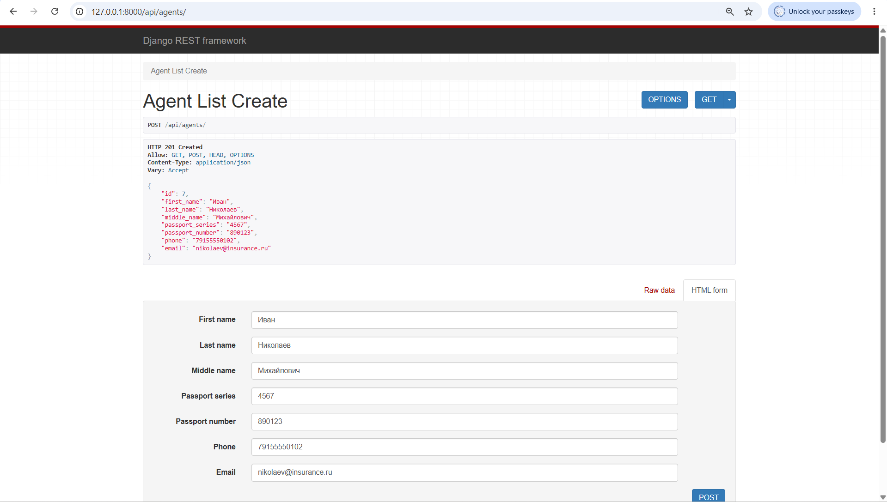

### 3.5 Создание индивидуального договора

`POST /api/contracts/` - тип «Индивидуальный», агент и физлицо передаются по id. Ответ `201 Created`: `organization: null`, `individual` - выбранное физлицо.

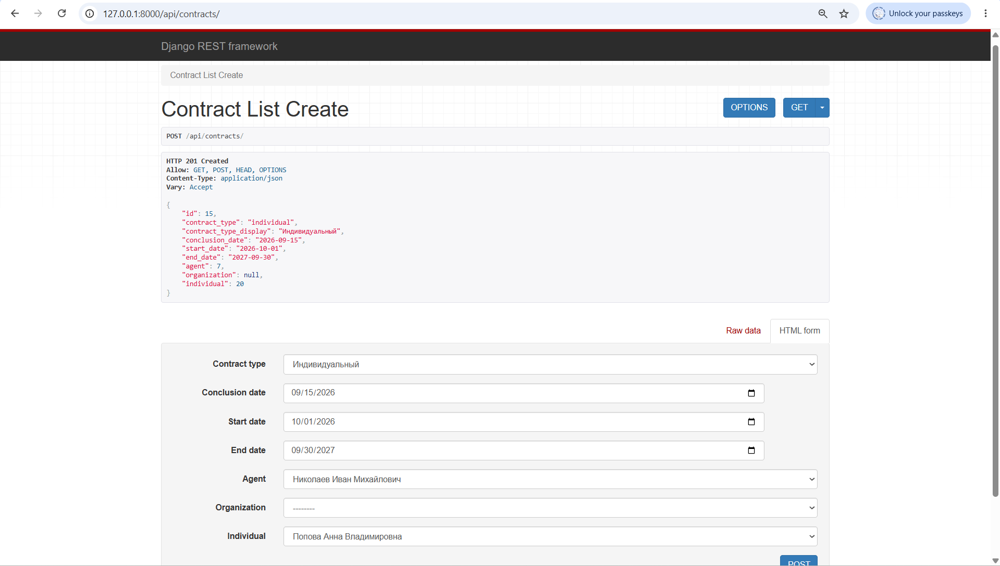

### 3.6 Частичное обновление

`PATCH /api/agents/7/` - отправлено только одно поле `{"email": "..."}`.

На скрине: ответ `200 OK`, возвращается полный объект агента, email обновлен.

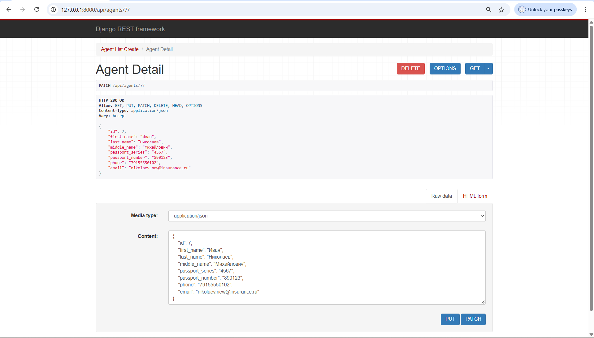

### 3.7 Удаление

`DELETE /api/contracts/15/` - ответ `204 No Content` с пустым телом. Затем удален и тестовый агент.

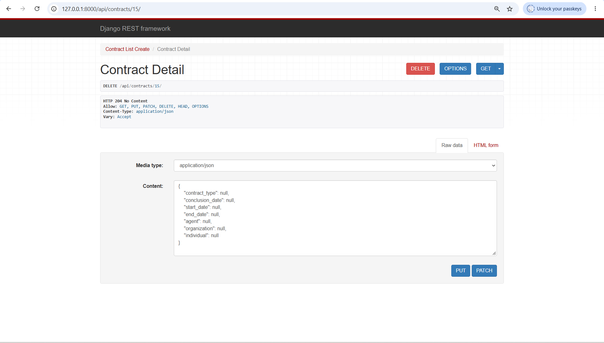

### 3.8 Регистрация пользователя

`POST /auth/users/` - регистрация через Djoser из PowerShell (POST-запрос с JSON-телом: username, email, password).

На скрине: ответ с созданным пользователем.

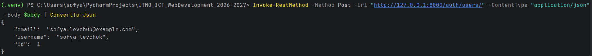

### 3.9 Получение токена

`POST /auth/token/login/` - обмен логина и пароля на токен.

На скрине: ответ `{"auth_token": "..."}` - ключ для авторизации дальнейших запросов.

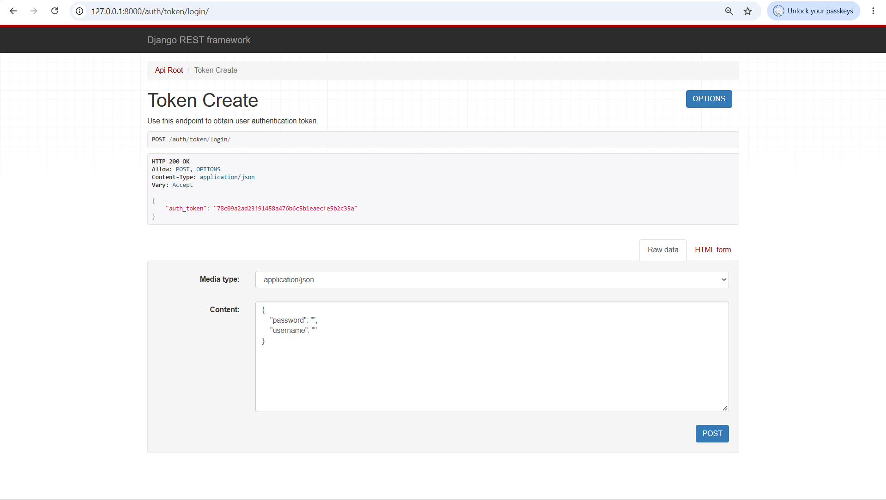

### 3.10 Текущий пользователь

`GET /auth/users/me/` с заголовком `Authorization: Token <ключ>` - DRF находит пользователя по токену.

На скрине: ответ с данными пользователя, выполнявшего запрос. Без заголовка тот же запрос возвращает `401 Unauthorized`.

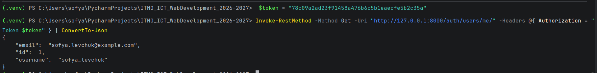

### 3.11 Аналитика: организации тех же агентов

`GET /api/analytics/organizations/4/same-agents/` (запрос 1) - для АО «Медик» найдены другие организации, застрахованные теми же агентами по действующим договорам.

На скрине: ГУП «Пассажиравтотранс» - общий агент Иванов, у него действующие договоры с обеими организациями. Просроченный договор в ответ не попадает.

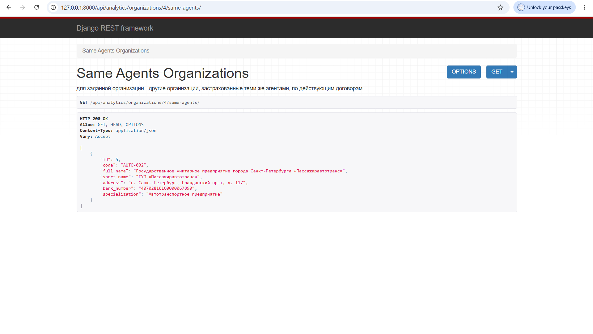

### 3.12 Аналитика: договоры каждого типа по агентам за период

`GET /api/analytics/agents/contracts-count/?date_from=2025-01-01&date_to=2026-12-31`.

На скрине: Иванов - 2 коллективных и 1 индивидуальный, Петров - 1 и 1, Сидоров - 0 и 1. Счетчики считаются одним запросом через `annotate(Count(..., filter=Q(...)))`; без параметров периода эндпоинт вернет `400` с подсказкой.

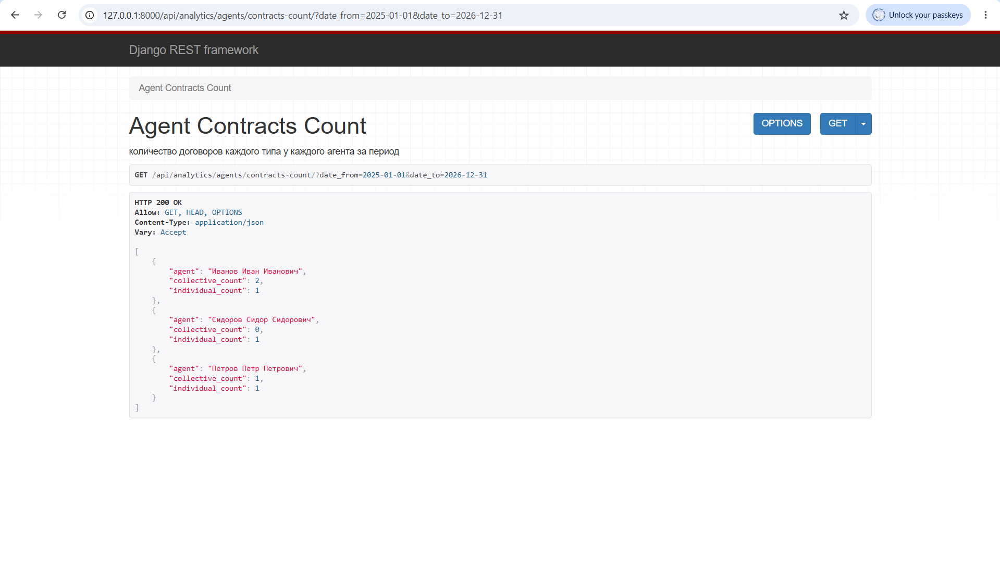

### 3.13 Аналитика: коллеги по коллективному договору

`GET /api/analytics/individuals/11/colleagues/` - для Смирнова выведены все застрахованные его действующего коллективного договора.

На скрине: договор №8 с АО «Медик», три сотрудника с возрастом и категорией риска. Индивидуальные договоры персоны в ответ не попадают.

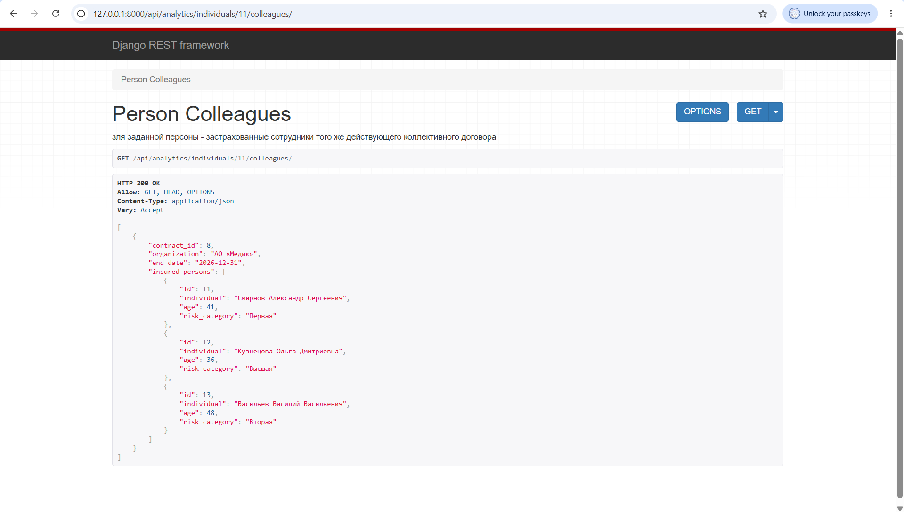

### 3.14 Аналитика: суммы выплат по типам договоров

`GET /api/analytics/payouts-by-type/?date_from=2026-01-01&date_to=2026-12-31`.

На скрине: индивидуальные - 500 000, коллективные - 830 000. Случай с отказом (Васильев) сумму не искажает: у него `payout_amount = NULL`, а `Sum` игнорирует NULL.

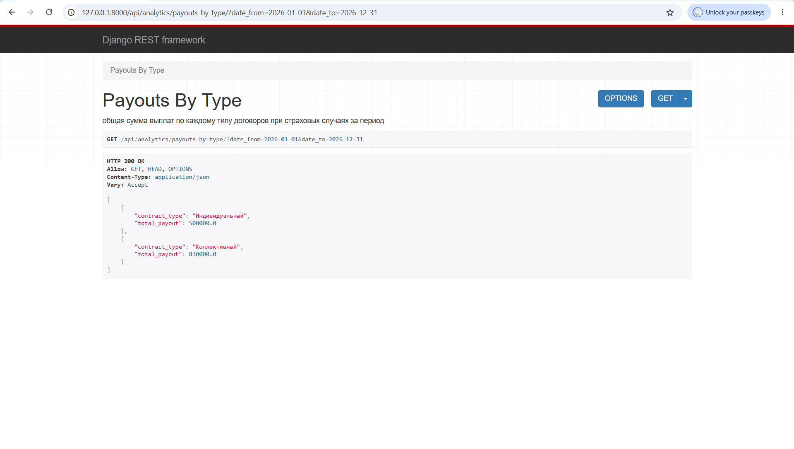

### 3.15 Аналитика: отчет по юридическим лицам

`GET /api/analytics/organizations/report/` - реквизиты каждого договора и суммы выплат по категориям риска.

На скринах: АО «Медик» - договор №8 (итог 700 000), «Пассажиравтотранс» - №9 (730 000), ИТМО - №10 (420 000) и просроченный №11 (100 000).

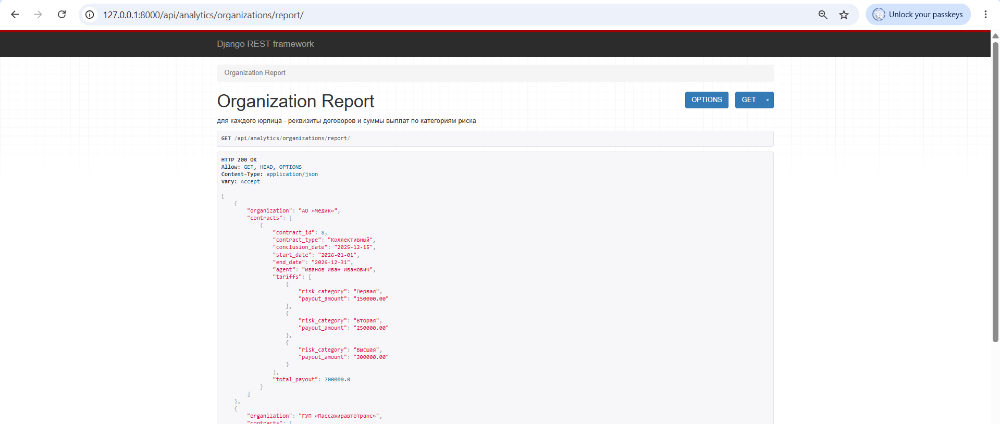
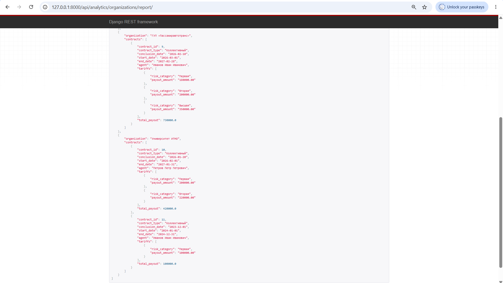

### 3.16 Аналитика: сводный отчет по фирме

`GET /api/analytics/firm-report/` - действующие договоры каждого типа, суммы по каждому работающему агенту и итог по фирме.

На скрине: Иванов - 2 коллективных + 1 индивидуальный (1 430 000 / 500 000), Петров - 1 + 1 (420 000 / 250 000). Уволенный Сидоров в список агентов не входит, но его действующий договор учтен в итоге фирмы: 3 + 3 договора, общая сумма 2 720 000.

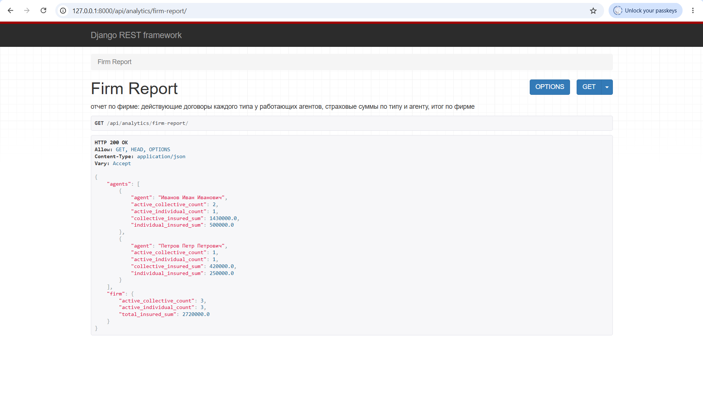

---
